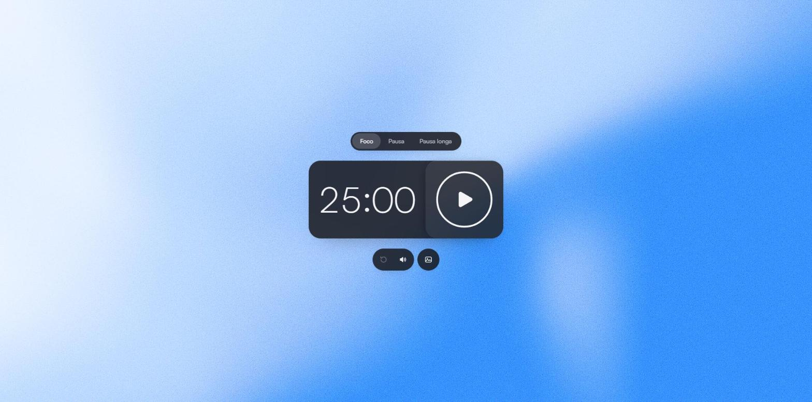
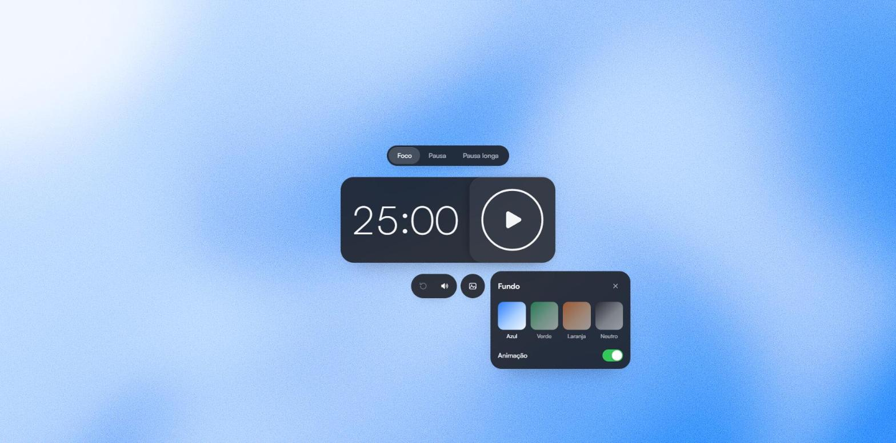

# Pomodoro

Timer Pomodoro minimalista com visual inspirado na Apple: vidro escuro, fundo em degradê fluido animado em WebGL, microinterações com física de mola e sons sintetizados em tempo real.




## Funcionalidades

- **Ciclo Pomodoro completo**: 25 min de foco, 5 min de pausa e pausa longa de 15 min a cada 4 sessões. A próxima etapa nunca começa sozinha.
- **Tempo preciso**: a contagem é baseada em timestamps, então não atrasa com a aba em segundo plano nem com o computador suspenso.
- **Sessão persistente**: ao recarregar a página, a sessão continua de onde parou. Se terminou com a página fechada, aparece como concluída, sem tocar o alarme de novo.
- **Sincronização entre abas**: duas abas abertas mostram a mesma sessão.
- **Desfazer em vez de confirmar**: reiniciar ou trocar de modo com uma sessão em andamento mostra um aviso com "Desfazer". Clicar no modo já selecionado não reinicia nada.
- **Alarme**: toca 5 vezes e para sozinho; qualquer ação ou a tecla `Esc` interrompe. Com a aba em segundo plano, também envia uma notificação.
- **Fundos personalizáveis**: quatro paletas (Azul, Verde, Laranja e Neutro), cada uma com seu próprio som, e opção de desligar a animação.
- **Sons em todas as interações**, sintetizados com Web Audio (sem nenhum arquivo de áudio), com botão para silenciar.
- **Ícone da aba dinâmico**: mostra play ou pause conforme o estado, junto com o tempo restante no título.
- **Atalho**: `Espaço` inicia e pausa.



## Prévia ao compartilhar

As tags Open Graph e Twitter Card ficam no `index.html`, disponíveis mesmo para aplicativos que não executam JavaScript. A imagem está em `public/og-image.jpg` (1200 × 630), com o visual do timer e a fonte Manrope.

Ao mudar de domínio, atualize o endereço canônico, `og:url`, `og:image` e `twitter:image` no HTML. Para recriar a arte, execute `python scripts/generate-social-preview.py` com Pillow e NumPy instalados. O script baixa a Manrope para a pasta temporária se necessário; a licença está em `public/fonts/Manrope-OFL.txt`. O build usa a imagem pronta e não depende de Python.

## Tecnologias

- **React 18** + **TypeScript**, com **Vite** como bundler.
- **WebGL** puro para o fundo animado (um fragment shader próprio, sem three.js).
- **Web Audio API** para todos os sons.
- **CSS** com container queries, `backdrop-filter` e tokens de design em variáveis CSS.
- Nenhuma biblioteca de UI, animação ou estado: a física de mola, os componentes e os hooks são do próprio projeto. A única dependência de runtime é o React.

## Como rodar

Requisitos: Node.js 22.6 ou superior (os testes usam o suporte nativo do Node a TypeScript).

```bash
npm install
npm run dev
```

Acesse http://localhost:5173.

| Comando           | O que faz                                              |
| ----------------- | ------------------------------------------------------ |
| `npm run dev`     | Servidor de desenvolvimento com hot reload             |
| `npm test`        | Testes da lógica do timer com o test runner do Node    |
| `npm run build`   | Checagem de tipos e build de produção em `dist/`       |
| `npm run preview` | Serve o build de produção localmente                   |

## Estrutura

O código é organizado por funcionalidade. `app` só compõe a tela; cada pasta em `features` contém tudo o que a funcionalidade precisa (modelo, hooks, componentes e estilos) e expõe uma API pública pelo `index.ts`; `shared` é reutilizável e não depende de nenhuma feature.

```
src/
├── main.tsx                     entrada: estilos base + App
├── app/                         composição da tela e layout da página
├── features/
│   ├── timer/
│   │   ├── model/timer.ts       lógica pura: estados, transições, persistência e desfazer
│   │   ├── hooks/               useTimer, usePomodoro, useCountdown, useAlarm
│   │   ├── components/          TimerFace, TimerRing, Digits, ModePicker, SessionControls, UndoToast
│   │   ├── favicon.ts         ícone da aba (play/pause)
│   │   ├── notifications.ts
│   │   ├── timer.css
│   │   └── index.ts
│   └── background/
│       ├── model/backgrounds.ts paletas
│       ├── gl/gradient.ts       shader WebGL do degradê
│       ├── hooks/useBackground  preferências e painel
│       ├── components/          GradientBackground, BackgroundPanel, BackgroundButton, BlobBackdrop
│       ├── sounds.ts            som de cada paleta
│       ├── background.css
│       └── index.ts
└── shared/
    ├── lib/                     spring (física de mola), sounds (Web Audio), keyboard
    ├── hooks/                   useSpring, usePress, useHover, useReducedMotion, useStored
    ├── ui/                      PressButton, IconButton, ícones animados
    └── styles/                  tokens.css e base.css
tests/
└── timer.test.ts
```

## Decisões técnicas

### Timer como modelo puro

Toda a regra do Pomodoro fica em `features/timer/model/timer.ts`, sem React nem DOM. Cada transição (`start`, `pause`, `selectMode`, `settle`…) é uma função pura que recebe o estado e o instante atual. Isso permite testar tudo de forma determinística com `node --test`, inclusive cenários como "a sessão expirou com a página fechada" ou "o relógio do sistema foi adiantado".

- A conclusão (`settle`) é **idempotente**: uma sessão só conclui uma vez, então o alarme e a contagem de ciclos nunca duplicam.
- `serialize` e `restore` são inversos exatos para estados válidos. Assim, abas sincronizadas não ficam reescrevendo o storage uma da outra.
- O "Desfazer" guarda o snapshot certo: trocar de modo várias vezes seguidas ainda recupera a sessão original.

### Renderização enxuta

- O componente raiz só re-renderiza em transições (iniciar, pausar, concluir), nunca a cada tick.
- O mostrador atualiza uma vez por segundo, alinhado à virada do segundo.
- O anel de progresso não é animado em JavaScript: a cada segundo o React define o próximo alvo e uma transição CSS linear faz o movimento contínuo.

### Fundo em WebGL

- Um único fragment shader gera o degradê com ruído suave e *domain warping*, com camadas que derivam em diagonais diferentes.
- Roda a 30 fps em cerca de 1/3 da resolução da tela. Como o degradê só tem baixas frequências, a ampliação feita pelo navegador é imperceptível.
- O granulado é uma textura SVG estática em resolução nativa, sobreposta com `mix-blend-mode`, por isso continua fino.
- Sem suporte a WebGL, um fundo em CSS assume.

### Movimento

- As animações usam uma física de mola própria (`shared/lib/spring.ts`) com integração em sub-passos, estável em qualquer taxa de quadros.
- Cada ícone tem um movimento próprio no hover: reiniciar gira para trás, som pulsa, fundo levanta. O play e o pause se transformam um no outro (morph) em vez de trocar de ícone.
- `prefers-reduced-motion` é respeitado em tudo, inclusive em animações disparadas por código, que viram mudanças instantâneas.

### Acessibilidade

- Seletor de modo e paletas seguem o padrão ARIA de radio group (setas, `Home` e `End`).
- O painel de fundos é um diálogo modal: prende o foco, fecha com `Esc` e devolve o foco a quem o abriu.
- Botões de ícone têm tooltips que também são o seu nome acessível.
- O estado da sessão ("Sessão 2 de 4", "Pausado", "Foco concluído") é anunciado a leitores de tela.
- O atalho de espaço não interfere em campos ou controles focados.

## Testes

```bash
npm test
```

Os testes cobrem a lógica do timer: precisão por timestamps, conclusão única, pausa longa a cada quatro focos, proteção contra reinícios acidentais, desfazer e persistência (recuperação, sessão expirada, dados corrompidos e relógio adiantado).
